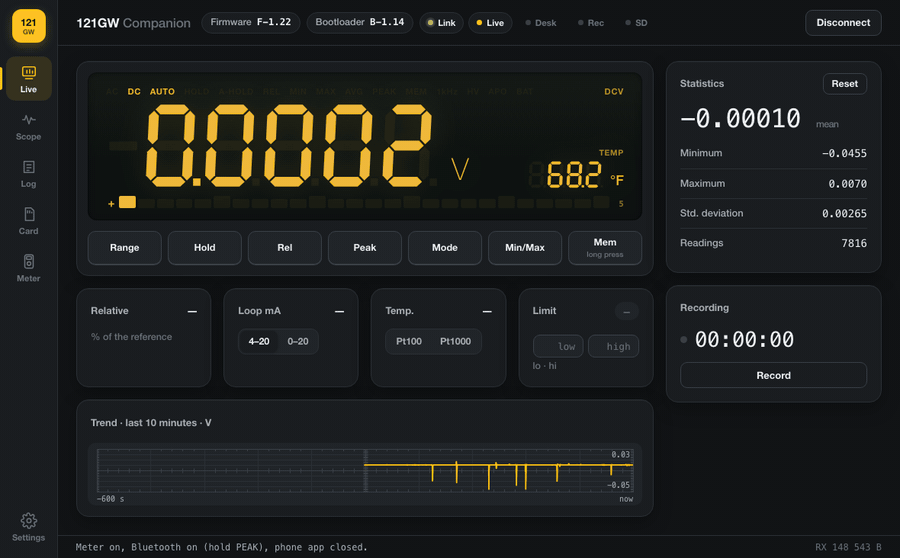
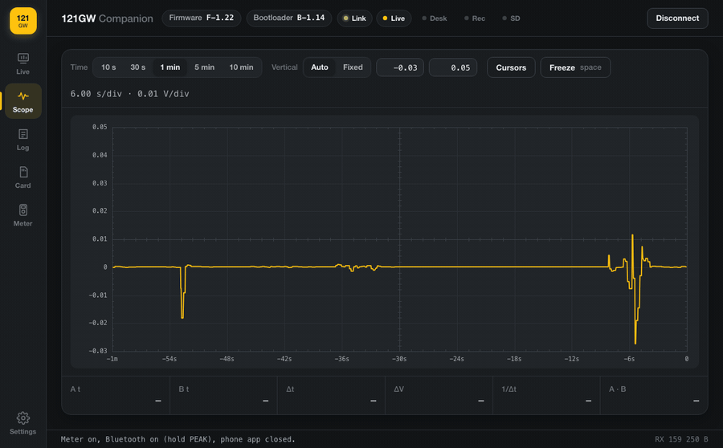
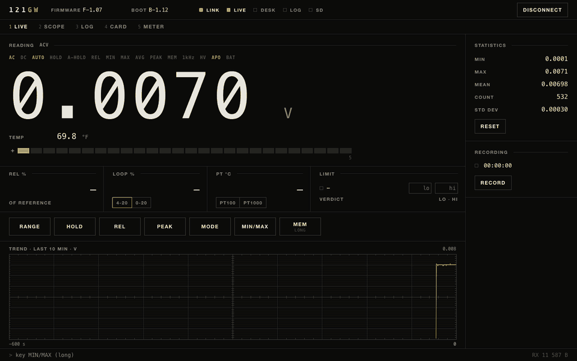
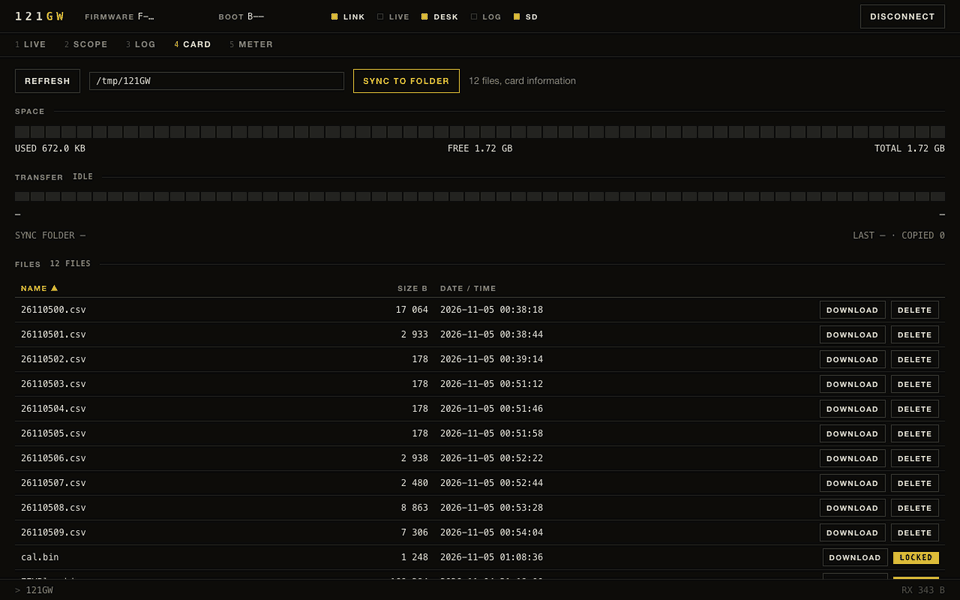
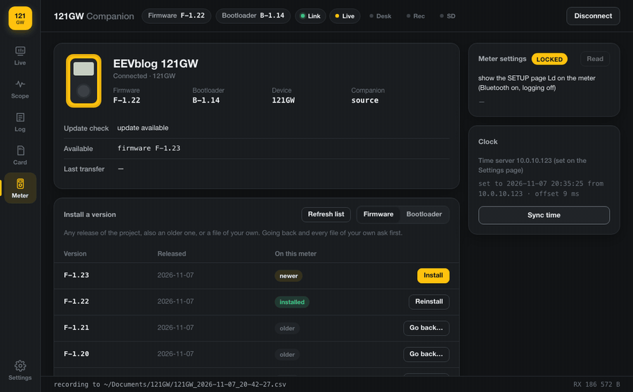

# 121GW Companion

A program for Windows, macOS and Linux that connects to an EEVblog 121GW multimeter over Bluetooth LE.

This is the branch `companion` of [121GW-Open-Firmware](https://github.com/zombu4/121GW-Open-Firmware): only the companion
program lives here.  The firmware and the emulator are on `main`, the build that behaves like v2.05 on `like-v2.05`.
What each version brought: [CHANGELOG.md](CHANGELOG.md).

| **Scope view** | **Recording** |
|---|---|
|  |  |
| **SD card** (meter on the page `Ld-bt`) | **Meter**: settings and diagnostics (page `Ld-bt`) |
|  |  |

Recorded from a real 121GW with firmware F-1.07 over Bluetooth (nothing connected to the inputs, so the readings are small; the keys are pressed from the computer; the meter's Bluetooth device identifier is covered).

## What it does

| | |
|---|---|
| Live view | the reading as the meter shows it: value with the meter's decimal point and unit for every mode and range, the small display (board temperature, frequency, dB, VA pages, setup values), the bargraph and the symbols (AC, DC, AUTO, HOLD, REL, MIN/MAX/AVG, PEAK, MEM, 1 kHz, high voltage, APO, battery) |
| Statistics | minimum, maximum, mean, standard deviation and count of the readings; they restart when the mode, unit or range changes |
| Trend | the last 6000 readings on a scope-style grid (10 minutes at the meter's 10 readings per second, 5 minutes at 20); the trace breaks where the meter had no value (overload, range change) |
| Recording | every reading with its time to a CSV file (`Documents/121GW` by default) |
| Firmware version | the fast firmware from F-1.02 on reports its version; the header shows it |
| Firmware and bootloader updates | when a newer firmware or bootloader release exists, a notice offers "Update both", "Firmware only", "Bootloader only" or "Later" (by default checked at every connection and every 30 minutes; SETTINGS offers daily or never).  With the two-part bootloader (releases `bl-vA.B.C`) the meter restarts into its update mode and receives the file over Bluetooth, nothing to press, then restarts into it.  With EEVblog's bootloader the firmware goes to the card on the page `Ld-bt` and the key sequence installs it; the first install of the two-part bootloader also goes through `Ld-bt` (firmware F-1.04 or newer, fresh batteries) |
| Install a version or a file | on the METER page a table lists every published firmware or bootloader release (a switch chooses which), also older ones than the meter has, each marked newer, installed, older, refused or "connect the meter"; its button (Install, Reinstall, Go back…) sends it through the same transfer as an update.  The list is read when a meter is connected, and with "Refresh list".  A file of your own (`.bin`, chosen or dropped on the page) is installed with one button: the program sees from the file whether it is firmware or a two-part bootloader image and refuses anything else, with the reasons.  Going back to an older release and every file of your own show what can break (what the newer version added, from the project's documents) and need you to type INSTALL first; the file is checked like a release image before anything is sent (firmware: size, stack pointer, reset vector; bootloader: the vector table of the two-part bootloader) and refused with the reason otherwise.  A bootloader file of your own is sent only to a meter that already has the two-part bootloader (the starter at the start of flash is written once and never again); firmware over 311296 bytes is refused when the meter has the two-part bootloader, which takes no more |
| Program version | the METER view shows this program's version; when the release check finds a newer `companion-vA.B.C` release, a notice with a button to its page appears |
| Bootloader | the meter's bootloader is shown next to the firmware version (EEVblog original, or B-A.BC) |
| Careful mode and link 2 | meters with the old Bluegiga BLE112 Bluetooth module (early v.01 boards; recognised by the link's packet size, MTU 23): the card list, downloads and the meter settings come in small pieces, each asked for again when damaged (firmware F-1.19 / F-1.25 or newer); with firmware F-1.31 or newer the readings come over link 2: small blocks with repair bytes at a steady pace, only what changed is sent, a damaged byte is repaired, the pace follows the link and is remembered per meter; with F-1.32 the card list, downloads and settings come in the same repaired blocks, in large pieces (GitHub issue 30) |
| Packed downloads and updates | firmware F-1.32: card files are packed by the meter (deflate) and unpacked by the companion, checked by their CRC-32; firmware F-1.32 (page Ld) and bootloader B-1.15 (update mode): updates are sent packed in 2 KiB pieces and checked by the meter exactly as plain ones; older versions get plain transfers (GitHub issue 30) |
| Heartbeat | with firmware F-1.26: a one-byte "still here" every 5 s; the meter switches its Bluetooth off and on after 15 s without one, which frees a connection the computer kept (GitHub issue 23); the companion reconnects a meter that stops answering and shows "Your meter is offline" after a minute |
| Diagnosis report | "Save report" on the METER view: one anonymised text file (versions, link, link details: damaged pieces, notification sizes and gaps, write confirmation times, signal strength, MTU, disconnects, status frame rate; last transfer, the firmware's diagnosis, settings, event log, and the events before this start of the program from the event log file, so a report saved after a failed update or after reopening the program still shows what happened) to attach to a GitHub issue; with SETTINGS "Extended diagnosis" on and firmware F-1.15 or newer also the meter's own link error counters, and with F-1.17 or newer the meter's clock measurement (its RC run clock against its crystal: as found, after the trim, the Bluetooth serial baud) |
| Meter clock | "Sync time" sets the meter's clock from an NTP server (pool.ntp.org, or your own) to the second; optionally after every connection |
| Seven pages | in the bar on the left: LIVE (the reading drawn as the meter's seven-segment LCD with its symbols and bargraph, derived values, statistics, the meter's keys), SCOPE (trend with two cursors: time, voltage and frequency differences), LOG (recordings), CARD (the SD card; with firmware F-1.17 or newer a button takes the meter off the page Ld-bt), METER (versions, updates, clock, diagnostics), METER SETTINGS (the meter's SETUP settings, a page of their own: GitHub issue 35), SETTINGS (this program's own: recordings and card sync folders, CSV format with decimal point or comma, dark, light or system colours, time server and clock on connect, update check on connect / daily / never, diagnostic logging, extended diagnosis, the offline window on or off, reset); keys 1..7 switch pages.  The page scales as a whole with the window; LIVE and SCOPE always show whole |
| Derived values | REL in percent, 4-20 / 0-20 mA loop percent, Pt100 / Pt1000 temperature from ohms (IEC 60751), a limit test with your own low and high limits (PASS / HI / LO) |
| Meter keys | RANGE, HOLD, REL, PEAK, MODE, MIN/MAX and MEM (long) from the computer |
| SD card (firmware F-1.05 or newer, meter on the page `Ld-bt`) | the card's files with size, date and time; download (about 1 KB/s, every 8 KB checked with a CRC-32), delete (cal.bin, EEVBlog.bin and BTLOAD.TMP are protected), free space, and "Sync to folder": new or changed files copied into a folder on the computer, nothing deleted there; "Format card" (firmware F-1.09 or newer with the two-part bootloader): the card formatted as exFAT after you type FORMAT |
| Settings (firmware F-1.05 or newer, page `Ld-bt`) | the meter's SETUP settings read and changed from the computer on the page METER SETTINGS: each row with its full name, the meter's page (its letters, or "page N" for the numbered pages of v2.05) and the value in words as the meter shows it (for example `DN 30`, `Lcd-3`, `30 s`, `0.1 Ω` steps); each stored as the meter's own page stores it, including the capacitance anti-hunting page `HUnt` (firmware F-1.16 or newer; the row is not shown for older firmware); calibration, serial number and rotary memory cannot be reached |
| Transfer statistics | after a transfer (update, card file) one line on what it spent its time on: packets and seconds, packets sent again, missing answers, damaged packets, resynchronisations, late answers, the slowest answer; it stays on the METER view as "last transfer" and goes into the report |
| Diagnostics | the meter's 26 SD card and transfer diagnosis values with their meaning (STATUS 0..25 on the page `Ld-bt`; a firmware before F-1.11 answers the first 21); STATUS 26..39 (the first write timeout, F-1.12) and 40..48 (the extended link diagnosis, F-1.15) are in the meter's firmware but are not shown here, except that the report carries the nine counters 40..48 when SETTINGS "Extended diagnosis" is on, and STATUS 49..55 (the clock measurement, F-1.17) likewise |

The meter accepts one Bluetooth connection at a time: close any other Bluetooth app for the meter before connecting.  Turn Bluetooth
on at the meter with a long press of PEAK.  While the SETUP page `Ld` (firmware transfer) is shown the meter sends no
readings.

## Everything included

The installers carry everything the program needs (Python, the Bluetooth library bleak, the window toolkit); nothing
else has to be installed.  The system provides only what every desktop has: macOS asks once for Bluetooth access,
Windows shows the window with its built-in WebView2 (otherwise the default browser opens), Linux uses its Bluetooth
service BlueZ and opens the program in the browser.

## Run from the source

    python -m pip install bleak pywebview
    python -m meter121            # from this folder; --browser, --no-open, --port N, --folder DIR (overrides the SETTINGS folder)

## Build

    python -m pip install bleak pywebview pyinstaller pillow
    python packaging/make_icons.py build/icons
    python packaging/third_party.py build/THIRD_PARTY_LICENSES.txt
    APP_VERSION=1.0.0 APP_ICON=build/icons/121gw-companion.icns pyinstaller --noconfirm packaging/companion.spec

then `packaging/make_dmg.sh` (macOS), `packaging/windows/121gw_companion.iss` (Inno Setup) or
`packaging/linux/build_appimage.sh` / `build_deb.sh`.

macOS with a Developer ID: `packaging/sign_macos.sh APP "Developer ID Application" [KEYCHAIN]` signs every binary and
the bundle (hardened runtime, timestamp); then `SIGNED=1 packaging/make_dmg.sh ...`, `codesign --timestamp --sign
"Developer ID Application" OUT.dmg` and `packaging/notarize_macos.sh OUT.dmg` (a notarytool keychain profile in
`NOTARY_PROFILE`, or an App Store Connect API key in `NOTARY_KEY`, `NOTARY_KEY_ID`, `NOTARY_ISSUER`) submit it to
Apple, wait for the verdict and staple the ticket.  A signed and notarized image opens without the "could not verify"
question.

CI (`.github/workflows/companion.yml`): every push runs the unit tests on macOS, Windows and Linux; the packages are
built, started and checked only for a release tag `companion-vA.B.C` (or a run started by hand).  The macOS package is
signed and notarized when the repository has the secrets `MACOS_CERT_P12` (the certificate and its key as .p12,
base64), `MACOS_CERT_PASSWORD`, `NOTARY_KEY_P8` (the API key .p8, base64), `NOTARY_KEY_ID` and `NOTARY_ISSUER`; without
them it is built unsigned as before.

## How it works

| File | |
|---|---|
| `meter121/link.py` | Bluetooth LE: scan, connect, notifications, writes, reconnect after the meter's auto power-off |
| `meter121/frames.py` | frames on the meter's byte stream (status, echoes, version answers, link counters F9, transfer answers), reassembled and checked; the skipped bytes are kept for the report |
| `meter121/display.py` | the status frame decoded as the meter's display shows it; the decimal point and unit tables come from the firmware |
| `meter121/record.py` | statistics, trend history, CSV recording |
| `meter121/server.py` | local server between the window and the program (127.0.0.1 only; commands need a custom header) |
| `meter121/releases.py` | the fast firmware's releases: latest version, image downloaded and checked (SHA-256, header) |
| `meter121/transfer.py` | the file transfer to the meter's SD card (packets with CRC-16, stop and wait, retries) |
| `meter121/clock.py` | NTP query and the meter's set-clock frame |
| `meter121/paths.py` | the user's settings, cache and documents folders |
| `meter121/eventlog.py` | the event log file `events.log` next to the settings file (one line per event, a marker per start, rotated at 1 MiB to `events.log.1`); it is not anonymised and is not meant to be sent as it is: send the report instead |
| `meter121/derived.py` | values computed on the computer: REL percent, 4-20 / 0-20 mA loop percent, Pt100 / Pt1000 temperature (IEC 60751), limit test |
| `meter121/keys.py` | remote keys (short and long codes of the firmware's key routine) |
| `meter121/card.py` | SD card file manager over the transfer link (list, download, delete, info) and the sync to a folder |
| `meter121/settings.py` | the meter's settings over the transfer link (read all, change one, range checked) |
| `meter121/diag.py` | the transfer's diagnosis values and their readable text |
| `meter121/STATE.md` | the state and command contract between the program and the page |
| `tests/` | unit tests, `python3 -I -m unittest discover -s tests` (no meter, no Bluetooth) |
| `meter121/app.py` | the program: link, version request, update, clock, window |
| `meter121/install.py` | what may be installed (any release, a file of your own) and the warnings before a downgrade or a file |
| `meter121/releases.py` | the project's releases on GitHub (lists, downloads, checks of images) |
| `ui/index.html` | the window |

The status frame does not carry the main decimal point or the unit prefix; both come from the firmware's tables
(`dec_table` in `firmware/src/mode/mode.s`, annunciators in `firmware/src/lcd/annun.s` on `main`).  What the frame cannot
tell is not shown rather than guessed: texts such as " LEAD", the port-only views (REL percent, loop percent, Pt100,
statistics pages), the dB reference, the 12-hour clock setting and the sign of an overload.

## Licence

Free for individuals, schools and non-profits to use, modify and share; companies need written permission from zombu4; selling or bundling only by zombu4 and EEVblog (David L. Jones), who both keep full rights. See `LICENSE`.
The installers also contain third-party software under its own licences (THIRD_PARTY_LICENSES.txt).
