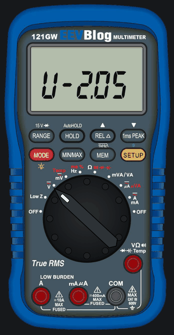

# 121GW-Open-Firmware — EEVblog 121GW open firmware port and emulator

| Folder | Content |
|---|---|
| `firmware/` | new firmware for the 121GW (STM32L152ZD) in hand-written Thumb-2 assembly, loaded by the meter's existing bootloader at 0x08006000 |
| `emulator/` | emulator of the 121GW with a front-panel UI, used to run and test firmware without hardware |

## New features of the fast build

| Feature | Where | What it does |
|---|---|---|
| Backlight auto-off and memory | SETUP page `bL` | switches the backlight off after 30 s .. 99 min; any key or dial turn switches it on again; the on/off state is kept over a power-off |
| dBm reference | ACV, SETUP dBm page | dBm into 600, 50 or 75 ohm, or dBV |
| Bluetooth speed | SETUP page `bt` | 2, 4, 10 or 20 readings per second |
| REL in percent | SETUP page `rEL` | REL shows the deviation from the reference in % |
| Thermocouple type | TEMP, SETUP page `tc` | K, J or T probes |
| Display level | SETUP page `dSP` | less smoothing: small changes show about 4x sooner |
| 12-hour clock | SETUP page `CL` | time page in 12-hour form |
| Statistics | MIN/MAX, pages `n` and `Sd` | count and standard deviation of the readings |
| Continuity hold time | BEEP, SETUP page `bH` | beep latch 100 / 50 / 25 ms or off (15 ms) |
| 4–20 mA in percent | DC mA, SETUP page `LP` | a 4–20 mA or 0–20 mA loop signal shown as 0–100 % |
| PT100 / PT1000 | Ω, SETUP page `Pt` | a platinum RTD read as a temperature in °C or °F (IEC 60751) |
| Limit test | SETUP pages `Lt`, `Lo`, `HI` | PASS / HI / Lo verdict against captured limits, with beeps |
| Logging trigger | SETUP pages `tr`, `Ch` | SD records every interval, on a change, or on a limit verdict change |
| MIN/MAX times | MIN/MAX, pages `tHI`, `tLo`; SD file | when the maximum and the minimum happened, on the meter and in the closing rows of the log file |

How to set and use each one: [`firmware/USER_GUIDE.md`](firmware/USER_GUIDE.md). The `1_like_v2.05` build has none of
these and behaves like the original firmware apart from the defect fixes.

## Downloads

Every release (tag `v*`, see [Releases](../../releases)) carries:

| File | Content |
|---|---|
| `firmware-<tag>.zip` | `2_fast/EEVBlog.bin` (production build), `1_like_v2.05/EEVBlog.bin` (strict build that behaves like v2.05 apart from the defect fixes), `USER_GUIDE.md` (the new features and how to use them), `FIXES.md` (the v2.05 defects fixed), `LICENSE`, `SHA256SUMS` |
| `121GW-Open-Firmware-Emulator-<tag>-macos-arm64.dmg` | emulator for macOS on Apple chips (M1 and later) |
| `121GW-Open-Firmware-Emulator-<tag>-macos-x86_64.dmg` | emulator for macOS on Intel |
| `121GW-Open-Firmware-Emulator-<tag>-windows-x64.exe` | emulator installer for Windows 10 / 11 |
| `121GW-Open-Firmware-Emulator-<tag>-linux-amd64.deb` | emulator package for Ubuntu, Debian, Mint, Pop!_OS |
| `121GW-Open-Firmware-Emulator-<tag>-linux-x86_64.AppImage` | emulator for any other 64-bit Linux |
| `<file>.sha256` | SHA-256 of the file with that name |

No file of a release contains an original EEVblog image (bootloader, v2.05) or the calibration of any meter.

## Firmware
- Build (GNU binutils arm-none-eabi 2.46, the `Makefile` refuses other versions): `cd firmware && make` (production) or
  `make LOOP_V205=1` (strict build that behaves like v2.05 apart from the defect fixes). `make check` runs the never-brick,
  HY3131-configuration and pin-policy checks and needs the original v2.05 image in `inputs/` (not in this repository);
  `make check-ci` runs the checks that do not need it and names the ones it skips. Output: `firmware/build/EEVBlog.bin`.
  `sh firmware/tools/build_dist.sh <dir>` builds both variants into the layout of the release archive.
- CI (`.github/workflows/firmware.yml`): on every push and pull request both variants are built with GNU binutils 2.46.0
  (built from the release tarball, SHA-256 pinned; the packages of Ubuntu 24.04 and 26.04 are 2.42 and 2.45.50) and checked with `make check-ci`
  (`check_image`, `check_hy` against the committed reference data `firmware/tools/hy_reference.txt`, `check_gpio`; skipped:
  `gen_nvm_allow --check`, `gen_ram_symbols --check`, `extract_tables --verify`, which compare with the original image). On a
  tag `v*` the workflow publishes `firmware-<tag>.zip`.
- `DESIGN.md` design and deviation list, `EEPROM_MAP.md` every EEPROM byte, `ORIGINAL_FIRMWARE_ISSUES.md` the defects
  found in v2.05 (with evidence), `OPTIMIZATIONS.md`, `FEATURES.md` user-visible features (keys, display, storage; implemented in the production build: backlight
  auto-off timer with remembered on/off state, selectable dBm reference, Bluetooth frame rate 2/4/10/20 per second,
  thermocouple type K/J/T, REL in percent, display level, 12-hour clock, statistics, continuity hold time, limit test, logging trigger, MIN/MAX times, 4–20 mA percent), `HARDWARE_TEST.md` checklist for the first run on a meter.
- Status: both builds match v2.05 in the emulator's 93 test scenarios and the STOP/wake scenario except documented
  deviations. Verified working on a meter (both builds). The strict build is compared frame by frame; in the production build the
  display during range changes is checked by the scenarios' assertions and final states.

### Flashing a meter from the SD card
Read `firmware/HARDWARE_TEST.md` first; it is the procedure and checklist.
1. Before flashing: dump the data EEPROM over SWD and save `cal.bin` to an SD card with v2.05 (HARDWARE_TEST.md, "Before
   flashing"). Keep both: they hold the meter's calibration, serial number and settings.
2. Unpack `firmware-<tag>.zip`. Copy one `EEVBlog.bin`, unchanged, to the root of a FAT32 SD card: `2_fast/EEVBlog.bin` or
   `1_like_v2.05/EEVBlog.bin`. The bootloader looks for exactly this file name (FAT short names ignore case).
3. Run the manual's Firmware Update procedure (page 72, summarised in HARDWARE_TEST.md, "Flashing"). The bootloader
   (0x08000000..0x08005FFF) is not changed; it writes the application from 0x08006000. The data EEPROM is not touched.
4. First boot and checks: HARDWARE_TEST.md. To return to v2.05, flash the original image the same way; settings and
   calibration stay readable (same EEPROM layout).

## Emulator
- **[How to start it, step by step with pictures](emulator/START.md).** Download, one confirmation the first time
  (the packages are not paid-signed), then it starts with a double-click; nothing else to install. On macOS and Windows
  the front panel opens in its own window (closing it stops the emulator); on Linux in the browser.
- It contains both firmware builds (choose one in the page) and loads any other `EEVBlog.bin` with **Load firmware
  file…** or by dropping the file on the window; it runs them without any original image (direct boot from the
  application's vector table) and starts with a SYNTHETIC EEPROM: made-up nominal calibration, not the calibration of any
  meter, with no serial number. Never copy it, or a `cal.bin` written by the emulator, to a meter.
- From the source tree: `sh firmware/tools/build_dist.sh /tmp/dist none && python3 emulator/tools/prepare_data.py --dist /tmp/dist`
  once (fills `emulator/data`), then `python3 emulator/app.py` and open http://127.0.0.1:8121. Needs Python 3 with
  `unicorn` and `capstone`. Own files: `--eeprom`, `--bootloader`, `--option-bytes`, `--v205-image`, `--app`, `--sdcard`;
  the original images are not included: they are read from a meter.
- `emulator/API.md`: HTTP API (`GET /state`, `POST /input`), Python API, options, what direct boot does not reproduce.
- `emulator/diff/run.py` compares two firmware images scenario by scenario (see its docstring); it needs the original v2.05
  image as the reference.
- CI (`.github/workflows/emulator.yml`) builds the packages above on a tag and attaches them to the release.

## Licence

Free to use, modify and share; selling or bundling only by zombu4 and EEVblog (David L. Jones). See `LICENSE`.
