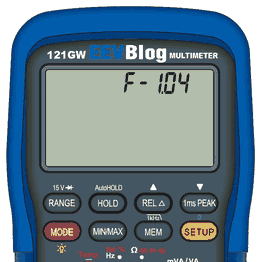
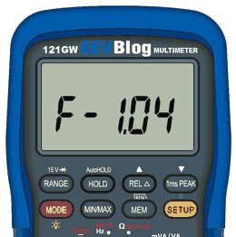
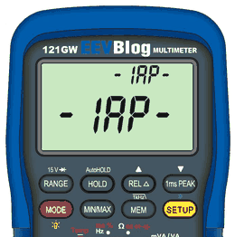
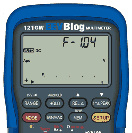

# Two-part bootloader for the EEVblog 121GW

A replacement for the meter's bootloader, written in Thumb-2 assembly, for this project's firmware (the fast build).
It lets the meter be updated over Bluetooth from the companion app, without a card and without holding keys, and it
updates itself the same way.  The old way, with the card and the keys, still works.

| First install (page `Ld-bt`, from the companion) | Firmware update over Bluetooth | Bootloader update over Bluetooth |
|---|---|---|
|  |  |  |

| Update from the SD card (MEM + HOLD, then SETUP) | Format the card as exFAT (setup page `Fr`) |
|---|---|
|  |  |

(Pictures from the emulator, time-lapse; the meter shows the same screens.)  Current release: **bl-v1.1.4**
(bootloader B-1.14), with firmware **v1.2.2** (F-1.22) and the companion **companion-v1.2.25**. What each version brought: [CHANGELOG.md](CHANGELOG.md).

## What it does

- **Update over Bluetooth.**  The companion asks the running firmware to restart into update mode, sends the new
  firmware with two packets in flight (about 1.5 KB/s on a meter: 157 KB in 108 s, against 160 s plus the key
  routine before) and the meter restarts into it.  The display shows `Ld nn` (percent) with the bargraph, `Ld oK`
  when the written firmware has been checked, `LdE n` if something failed.
- **Never installs a broken file.**  From the card, the whole `EEVBlog.bin` is read and checked first (size, vector
  table, CRC-32); only then is anything erased.  After programming, the flash is compared with the file.
- **Never starts a broken firmware.**  A "valid firmware" mark is written last.  If an update is interrupted (power
  cut, weak signal), the mark is missing and the meter stays in update mode (`-IAP-`) until a good firmware arrives.
- **Updates itself safely.**  A small starter at the start of flash is written once and never again.  A new
  bootloader goes into a spare slot first; the starter copies it in at the next start (about 1 s).  A power cut during
  that copy repeats the copy.  A new bootloader that never confirms its start is replaced by the previous one at the
  next start (take the batteries out and put them back).
- **30 seconds** to press SETUP after MEM + HOLD at power-on (the old bootloader allowed about 8 s).
- **Reads exFAT and FAT32 cards** for the card update (FatFs R0.16, read only), so the card can be formatted as
  exFAT on the meter (setup page `Fr`, shown only while this bootloader is installed: EEVblog's bootloader cannot
  read exFAT).
- **Never touches the data EEPROM** (calibration, serial number, settings) or the option bytes.

## How to

### Install it (once per meter)

You need the companion app (**companion-v1.1.0** or newer), this project's firmware **v1.0.4** (F-1.04) or newer on
the meter (the companion updates the firmware first if needed, through EEVblog's bootloader and the card routine), and
**fresh batteries**: the meter refuses below 4.80 V (`LdE 8`).

1. Connect the companion; it shows *bootloader: EEVblog original* and offers the newest bootloader release
   (`bl-vA.B.C`).
2. Click **Update now** (or *Bootloader only*).
3. On the meter: press **SETUP** until `SEt`, hold **SETUP** until the long beep (the meter pages), then press
   **SETUP** until `Ld-bt`.  The transfer starts by itself (about 15 s; several minutes with the old BLE112 module).
4. The meter restarts, installs the bootloader (about 1 s, display blank) and starts the firmware.  The companion
   reconnects and shows the new bootloader.

The meter checks first that it still has one of EEVblog's two known bootloader builds; anything else is refused
(`LdE 7`) and nothing is written.  The only moment where a power cut would leave the meter without a start is the
writing of the starter's first page, about 10 ms (datasheet times).  After that, every update is safe.

### Update the firmware

- **With the companion:** click **Update now** when it offers a new firmware.  The meter restarts into update mode
  (`-IAP-`), shows the progress, `Ld oK`, and restarts into the new firmware.  Nothing to press on the meter.
- **With a card:** copy the firmware as `EEVBlog.bin` to the card's root, switch the meter off, hold **MEM** and
  **HOLD** while switching it on, then press **SETUP** within 30 s.  The display shows `douun` with the bargraph, then
  ` Good`, and the firmware starts.  ` FAIL` means the file was refused or could not be read; nothing was erased.

### Update the bootloader

With the companion: **Update now** (or *Bootloader only*) when it offers a newer bootloader.  The meter restarts into
update mode, receives the bootloader (about 15 s), restarts; the starter installs it.

### Format the card as exFAT (optional)

On the meter: SETUP pages up to `Fr` (after `Ld`), long **SETUP** (`Fr no` blinks), **REL** for `Fr yE`, long
**SETUP** again.  `Fr --` while it formats, `Fr oK` when done; everything on the card is gone.  `FrE n` = failed
(FatFs result n), `FrE L` = refused while logging or in calibration mode.  Only offered while this bootloader is
installed.

### If something goes wrong

| What you see | What it means | What to do |
|---|---|---|
| `-IAP-` on both displays, stays | no valid firmware (an update was interrupted) | send the firmware again with the companion, or use a card |
| `LdE 2` / `LdE 3` / `LdE 6` | the image was refused (length or CRC wrong / not a firmware) or a flash write failed | send it again |
| `LdE 7` in update mode (B-1.15) | a packed update arrived damaged; the meter stays in update mode | send it again |
| blank display after a bootloader update | the new bootloader did not start | take the batteries out and put them back: the starter puts the previous bootloader back |
| `LdE 7` at the first install | the meter does not have one of EEVblog's bootloaders | nothing was written; the bootloader is probably already installed |
| `LdE 8` at the first install | battery too low | fresh batteries |

Without any valid firmware the meter stays in update mode; after 10 minutes without a connection it switches its
Bluetooth module off to save the batteries, any key switches it on again.

## For developers

- Design, decisions and the hardware facts behind them: [DESIGN.md](DESIGN.md).
- Build: `make` in `firmware/` first (the bootloader links the firmware's SD driver, FatFs, GPIO and clock objects),
  then `make` here: `build/starter.bin`, `build/bootloader.bin`, `build/install.bin` (first install file),
  `build/*.sha256`.
- Tests in the emulator: `make test` (starter decisions and power cuts, the bootloader scenarios B1..B9, the first
  install from EEVblog's bootloader; the last needs EEVblog's bootloader images, which are not in this repository).
- Pictures: `python3 -I bootloader/tools/make_gifs.py bootloader/docs [--eevblog-bootloader FILE]` from the
  repository root (Pillow, Playwright with Chromium); `first_install.gif` needs one of EEVblog's bootloader images,
  which are not in this repository.
- Flash layout: starter 0x08000000..0x080003FF, bootloader 0x08000400..0x08005EFF, its mark 0x08005F00, firmware
  0x08006000..0x08051FFF, slots 0x08052000 and 0x08058000, control records 0x0805E000, firmware mark 0x0805FF00.
- Recovery over SWD (developers with a probe): write the dump of the original bootloader back to 0x08000000
  (`flash write_image erase bootloader_dump.bin 0x08000000`, `verify_image`); never mass-erase and never touch the
  option bytes; keep a dump of the data EEPROM.
